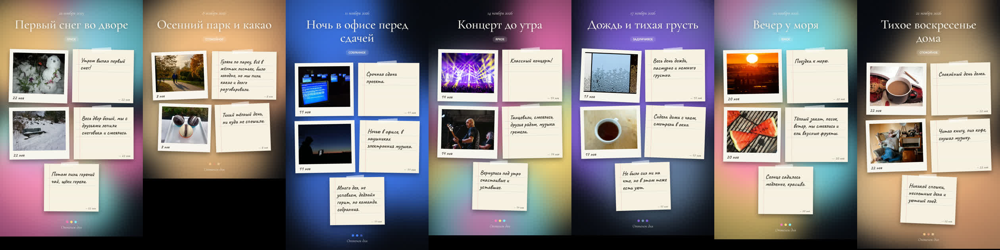

# Оттенок дня

**Дневник, где каждый прожитый день становится пятном краски.** Genesis · ArtTech 2026, тема «Make the invisible visible».

- Прототип: https://the-days-hue.tryfx.workers.dev — работает в браузере на ПК и телефоне, без регистрации, можно установить как приложение и пользоваться без интернета.
- Код: https://github.com/0trying-ui/the-days-hue
- Видео: (ссылка будет добавлена)

---

## Описание

**Идея.** Настроение дня нельзя сфотографировать — оно невидимо. «Оттенок дня» делает его видимым: человек пишет пару строк о дне (или надиктовывает), прикладывает фото и песню, и день превращается в живое пятно краски. Его цвет, форма и движение — это настроение дня. Пятна выстраиваются по датам в ночном небе, месяцы собираются в туманности из цветов своих дней. В любое пятно можно «нырнуть»: оно падает каплей в воду, краска разливается и становится фоном, а навстречу летят фото, листки заметок и пластинка с песней дня.

**Для кого.** Для тех, кто хочет помнить не события, а ощущение от дня: подростки и взрослые, которые ведут дневник, но не любят писать много; для тех, кто вспоминает картинками и музыкой. Всё личное хранится только в браузере человека: ни аккаунта, ни облака.

**Визуальная система.**

| Постоянно (одно для всех дней) | Меняется (зависит от дня) |
| --- | --- |
| Ночное небо со звёздами и тонкими нитями между днями | Палитра пятна: цвета событий и фото дня, притянутые к тону настроения |
| Форма пятна: мягкая сфера живой краски из шейдера | Движение: скорость «дыхания», дрожь, резкость края, течение красок внутри |
| Порядок по датам: лента дней, месяцы — туманности | Фоновая музыка: лад, темп, тембр по настроению |
| Шрифты: засечный для названий и дат, системный для интерфейса, рукописный для заметок | Погода внутри дня: дождь, снег, ветер, туман, солнце — если они упомянуты |
| Место даты и названия, фото — полароиды, песня — пластинка | Название папки дня: 3–7 слов в тоне настроения |

**Как ввод меняет результат.**

- **Текст.** ИИ (или встроенный алгоритм без интернета) читает события и чувства: определяет одно из четырёх настроений, энергию и тон, подбирает три цвета по событиям (море — лазурь и песок, закат — коралл и золото, дедлайн — индиго), придумывает название папки, делит текст на листки и находит погоду.
- **Фото.** Из снимков берётся палитра; ИИ сверяет цвета с ними. Первое фото становится обложкой пластинки.
- **Музыка.** Файл анализируется прямо в браузере (Web Audio): темп, энергия, яркость тембра влияют на энергию дня. В дне песня звучит фрагментом около минуты с самого яркого места — приглушённо, «как из-под воды», — а пятно пульсирует в такт басу. Песню можно дать ссылкой Spotify или SoundCloud.

| Настроение | Цвет | Движение | Звук |
| --- | --- | --- | --- |
| Спокойное | тёплый янтарь, мягкая насыщенность | медленное дыхание, плавное течение | мажор, ~58 уд/мин, мягкий тембр |
| Яркое | сочнее и светлее | пружинящий пульс, живые переливы | мажор, ~96 уд/мин, светлый тембр |
| Напряжённое (собранное) | холоднее, к синему, темнее | мелкая дрожь, плотные края, быстрое течение | минор, ~108 уд/мин, резкий тембр |
| Задумчивое | приглушённый фиолетовый | тяжёлое медленное течение вниз, как дождь | минор, ~52 уд/мин, тёмный тембр |

---

## Художественные приёмы

| Приём | Референсы | Где и для каких настроений |
| --- | --- | --- |
| Цветовое поле с мягким краем | Марк Ротко, абстракция цветового поля | каждое пятно; мягкий край у спокойных и задумчивых дней, плотный — у напряжённых |
| Живой пигмент с завихрениями внутри | мраморирование, эбру; шумы Перлина и «domain warping» Иниго Килеса | течение красок внутри пятна, скорость по настроению |
| Цвет как настроение | фовизм (Матисс) — для ярких дней; «Ноктюрны» Уистлера — для задумчивых | тон пятна: тёплый, сочный, холодный или фиолетовый |
| Туманность | астрофотография, снимки туманностей телескопа Hubble | месяц — одна туманность, её участки — цвета разных дней |
| Капли, которые сливаются и разделяются | поверхностное натяжение воды; метаболы (Джим Блинн) | переход между месяцами: дни сливаются в одну каплю и снова расходятся |
| Капля краски в воде | суминагаси, фотографии чернил в воде (Ким Кивер) | вход в день: пятно падает каплей, разливается и становится фоном |
| Полароиды и рукописные листки | эстетика альбома, мгновенной фотографии и бумажного дневника | стена воспоминаний внутри дня |
| Звук «издалека» | приглушённый звук воспоминаний в кино | песня дня через фильтр низких частот с медленным колебанием |
| Генеративный эмбиент | Брайан Ино, «музыка для аэропортов» | фон для неба и для каждого дня, лад и темп по настроению |
| Погода внутри дня | импрессионизм: дождь и туман у Моне | частицы дождя, снега, ветра, тумана, если они упомянуты в заметке |

---

## Примеры дней

Семь дней встроены в прототип и видны сразу после входа (названия папок придуманы прототипом по тексту). Картинки — открытки дней, которые нарисовал сам прототип (кнопка «Открытка» внутри дня), лежат в папке [examples](examples).



| Папка дня | Настроение | Что внутри | Картинка |
| --- | --- | --- | --- |
| Первый снег во дворе | яркое | снеговик, горячий чай, белый двор | [открытка](<examples/01 — Первый снег во дворе.png>) |
| Осенний парк и какао | спокойное | жёлтые листья, какао, долгий разговор | [открытка](<examples/02 — Осенний парк и какао.png>) |
| Ночь в офисе перед сдачей | собранное | дедлайн ночью, электронная музыка | [открытка](<examples/03 — Ночь в офисе перед сдачей.png>) |
| Концерт до утра | яркое | танцы, свет сцены, друзья | [открытка](<examples/04 — Концерт до утра.png>) |
| Дождь и тихая грусть | задумчивое | дождь за окном, чай, уют | [открытка](<examples/05 — Дождь и тихая грусть.png>) |
| Вечер у моря | яркое | закат, песок, ветер | [открытка](<examples/06 — Вечер у моря.png>) |
| Тихое воскресенье дома | спокойное | книга, кофе, плед | [открытка](<examples/07 — Тихое воскресенье дома.png>) |

Фото демо-дней — с Wikimedia Commons под свободными лицензиями, авторы перечислены в [CREDITS.md](CREDITS.md) и на странице сайта «Фото в демо-днях» (https://the-days-hue.tryfx.workers.dev/credits).

---

## Использованные инструменты

**Сайт (без фреймворков, свой код):** WebGL — свой шейдер краски (пятна, туманности, жидкое слияние капель); CSS 3D — прогулка внутрь дня; Canvas 2D — ритуал капли, нити, следы пальца, открытка; Web Audio API — анализ песни, генеративный эмбиент, «подводный» фильтр; MediaRecorder — диктовка; IndexedDB и Service Worker — хранение дней и работа без интернета; esbuild — сборка.

**API и ИИ:**
- Groq — GPT-OSS 120B (анализ дня по тексту), Qwen 3.8 27B (анализ с фото), Whisper Large v3 Turbo (диктовка);
- Google Gemini — Flash-Lite и Flash (запасной анализ), Gemini TTS (озвучка заметок с интонацией дня);
- Cloudflare Workers AI — Llama 3.3 70B и Whisper (последний запасной вариант);
- Spotify и SoundCloud — встроенные плееры и oEmbed (обложки и песни по ссылке), Apple Music — обложка по ссылке.

**Хостинг:** Cloudflare Workers (сайт и прокси для ИИ, ключи только в секретах), Durable Objects (дневные нормы на посетителя).

**Готовые ресурсы:** шрифты Cormorant Garamond и Caveat (Google Fonts), фото демо-дней с Wikimedia Commons.

**Видео:** HyperFrames и GSAP (монтаж), Puppeteer (запись экрана), FFmpeg.

**ИИ-инструменты разработки:** Claude (Anthropic) в Claude Code — помощь в написании кода, дизайне и проверке.

---

## Запуск

```bash
node server.mjs            # локально: http://localhost:5173
node build.mjs             # сборка в dist/
npx wrangler deploy -c wrangler.site.toml          # сайт
cd worker && npx wrangler deploy -c wrangler.toml  # прокси для ИИ
```

Ключи ИИ задаются только как секреты Cloudflare: `npx wrangler secret put GROQ_API_KEY`, `npx wrangler secret put GEMINI_API_KEY`. Без ключей сайт работает на встроенном алгоритме.

**Структура:** `index.html`, `css/style.css` — интерфейс; `js/scene.js` — шейдер и сцена; `js/main.js` — логика; `js/analyze.js` — настроение без ИИ; `js/ritual.js` — капля; `js/sound.js` — звук; `js/embed.js` — плееры по ссылкам; `worker/` — прокси для ИИ; `DESIGN_SYSTEM.md` — правила визуальной системы.
